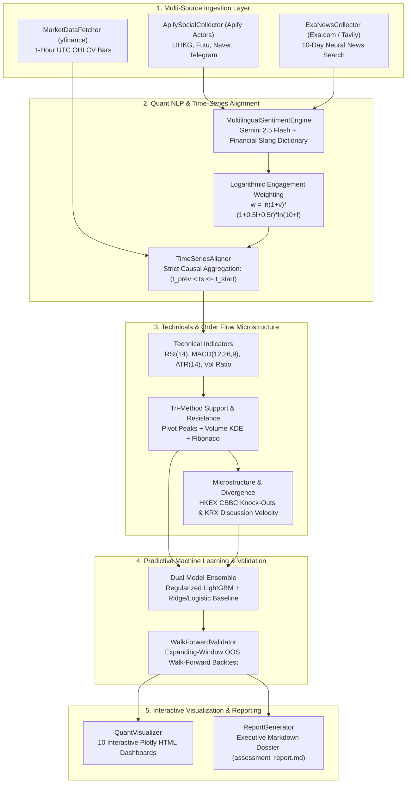

# Hang Seng & KRX Sentiment Price Prediction Agent
### Institutional-Grade Quant Pipeline for Asian Equities (HKEX & KRX)
**Internship Technical Assessment — CrowdWisdomTrading**

[](https://www.python.org/downloads/)
[]()
[](https://opensource.org/licenses/MIT)

---

## 1. Executive Summary & Architecture

This repository delivers an end-to-end quantitative intelligence agent that forecasts equity price direction and returns at horizon $n+1$ across **10 benchmark equities** in Greater China (**HKEX Hang Seng Index**) and South Korea (**KRX KOSPI**).

The system integrates **asynchronous multilingual retail social sentiment** (Cantonese from LIHKG / Futu Community; Korean from Naver Finance Board and Telegram) with **institutional news flows** (Exa.com neural search with Tavily fallback). Natural language signals are classified via a dual-strategy engine (Gemini 2.5 Flash LLM + localized financial slang lexicons), synchronized to strict UTC hourly market bars with **zero lookahead bias**, fused with tri-method Support/Resistance levels (Rolling Extremas, Volume-Weighted KDE, and Fibonacci), and predicted using regularized LightGBM evaluated under an **expanding-window walk-forward out-of-sample backtest**.



---

## 2. Target Assets (HKEX & KRX)

The pipeline monitors 10 blue-chip constituents with automated query expansion for regional slang, cashtags, and native tickers:

| Exchange | Ticker | Company Name | Cashtags | Regional Keywords / Slang |
| :--- | :--- | :--- | :--- | :--- |
| **HKEX** | `0700.HK` | Tencent Holdings | `$0700`, `$TCEHY` | 騰訊, 鵝廠, 企鵝 |
| **HKEX** | `9988.HK` | Alibaba Group | `$9988`, `$BABA` | 阿里巴巴, 阿里, 巴巴 |
| **HKEX** | `3690.HK` | Meituan | `$3690`, `$MPNGF` | 美團, 外賣 |
| **HKEX** | `1810.HK` | Xiaomi Corp | `$1810`, `$XIACY` | 小米, 雷軍 |
| **HKEX** | `1211.HK` | BYD Company | `$1211`, `$BYDDY` | 比亞迪, 電車 |
| **KRX** | `005930.KS`| Samsung Electronics| `$005930` | 삼성전자, 삼전, 십만전자 |
| **KRX** | `000660.KS`| SK Hynix | `$000660` | SK하이닉스, 하이닉스 |
| **KRX** | `035420.KS`| NAVER Corp | `$035420` | 네이버 |
| **KRX** | `035720.KS`| Kakao Corp | `$035720` | 카카오 |
| **KRX** | `373220.KS`| LG Energy Solution | `$373220` | LG에너지솔루션, 엔솔 |

---

## 3. Apify & Exa Reproduction Details

As requested in the assessment submission requirements, reviewers can fully reproduce this pipeline using live APIs or zero-credit offline mode:

### Apify Actor IDs
Configured in `config/settings.yaml`:
* **Forum Scraper (LIHKG & Naver Finance)**: `apify/cheerio-scraper`
* **Web Scraper (Futu / General Community)**: `apify/web-scraper`
* **Telegram Scraper (Financial Alerts)**: `apify/telegram-scraper`

### News Retrieval (Exa & Tavily)
* **Primary**: Exa neural semantic search (`exa-py`) bounded by `start_published_date` over the 10-day lookback window.
* **Secondary / Fallback**: Tavily search API (`tavily-python`) automatically triggers if `EXA_API_KEY` is unavailable.

### Zero-Credit Offline Reproduction Mode
To ensure the pipeline can be evaluated even if API tokens expire or rate limits are reached, setting `USE_MOCK_DATA=true` in `.env` activates high-fidelity synthetic data generators reflecting authentic Cantonese and Korean financial discussions.

---

## 4. Key Quantitative & Engineering Innovations

### A. Point-in-Time Correctness & Zero Lookahead Bias
For any hourly price bar $B_t$ starting at $t_{\text{start}}$, all social and news items are filtered strictly by:
$$t_{\text{prev\_bar\_start}} < \text{timestamp}_i \le t_{\text{start}}$$
Future items are strictly quarantined, ensuring true out-of-sample causal validity.

### B. Engagement-Weighted Sentiment
Raw counts fail to capture viral market impact. Posts are weighted using a logarithmic engagement curve:
$$w = \ln(1 + \text{views}) \times (1 + 0.5 \times \text{likes} + 0.5 \times \text{reposts}) \times \ln(10 + \text{followers})$$

### C. Tri-Method Support & Resistance Synthesis
To avoid arbitrary static lines, $S_1, S_2, R_1, R_2$ are algorithmically synthesized from:
1. **Rolling Pivot Extrema**: Local peaks ($H$) and troughs ($-L$) via `scipy.signal.find_peaks`.
2. **Volume-Weighted Kernel Density Estimation (KDE)**: High-density liquidity consolidation nodes via `scipy.stats.gaussian_kde` weighted by trade volume.
3. **Fibonacci Retracements**: 0.236, 0.382, 0.500, 0.618, and 0.786 retracement levels across the 10-day range.
*Guaranteed ordering*: $S_2 < S_1 < P_{\text{current}} < R_1 < R_2$.

### D. Regional Market Microstructure
* **HKEX**: Monitors spot distance to Callable Bull/Bear Contract (CBBC 牛熊證) knock-out barrier clusters near $S_1$ and $R_1$, anticipating market maker delta-hedging liquidity sweeps.
* **KRX**: Tracks rolling Z-scores of Naver discussion volume ($\text{mention\_zscore}$) to identify retail FOMO spikes ($Z > +1.8$) or panic capitulation exhaustion.

---

## 5. Master Quantitative Scorecard

*Current Market Regime across all 10 assets:*

| Ticker | Asset Name | Market | Current Price | Sentiment Score & Label | Direction | Pred Price ($n+1$) | Win Prob | Action | $S_1$ / $S_2$ | $R_1$ / $R_2$ | Risk:Reward |
| :--- | :--- | :---: | :---: | :---: | :---: | :---: | :---: | :---: | :---: | :---: | :---: |
| **0700.HK** | Tencent Holdings | HKEX | HK$ 407.15 | `+0.834` (EXTREMELY BULLISH) | **BULLISH** | **HK$ 407.78** | 73.6% | `LONG` | 404.27 / 400.46 | 411.47 / 417.24 | 0.75x |
| **9988.HK** | Alibaba Group | HKEX | HK$ 87.44 | `+0.000` (NEUTRAL) | **BEARISH** | **HK$ 87.42** | 35.2% | `SHORT` | 86.91 / 85.37 | 87.86 / 88.64 | 0.55x |
| **3690.HK** | Meituan | HKEX | HK$ 153.74 | `+0.000` (NEUTRAL) | **BULLISH** | **HK$ 154.08** | 76.2% | `LONG` | 152.42 / 150.24 | 154.54 / 156.86 | 0.36x |
| **1810.HK** | Xiaomi | HKEX | HK$ 29.04 | `+0.000` (NEUTRAL) | **BEARISH** | **HK$ 29.12** | 68.0% | `SHORT` | 28.80 / 28.62 | 29.40 / 29.79 | 0.43x |
| **1211.HK** | BYD | HKEX | HK$ 256.09 | `+0.000` (NEUTRAL) | **BULLISH** | **HK$ 256.06** | 55.2% | `LONG` | 253.25 / 250.21 | 258.20 / 260.02 | 0.48x |
| **005930.KS** | Samsung Electronics | KRX | ₩ 58,196 | `+0.000` (NEUTRAL) | **BULLISH** | **₩ 58,206** | 77.9% | `LONG` | 57970 / 57675 | 58752 / 59494 | 0.93x |
| **000660.KS** | SK Hynix | KRX | ₩ 182,891 | `+0.000` (NEUTRAL) | **BULLISH** | **₩ 183,238** | 46.0% | `LONG` | 181764 / 179034 | 183208 / 185443 | 0.14x |
| **035420.KS** | NAVER | KRX | ₩ 178,719 | `+0.000` (NEUTRAL) | **BULLISH** | **₩ 178,654** | 56.5% | `LONG` | 176996 / 176010 | 179132 / 180187 | 0.16x |
| **035720.KS** | Kakao | KRX | ₩ 36,748 | `+0.000` (NEUTRAL) | **BEARISH** | **₩ 36,734** | 56.1% | `SHORT` | 36512 / 36063 | 37294 / 37639 | 0.31x |
| **373220.KS** | LG Energy Solution | KRX | ₩ 320,629 | `+0.000` (NEUTRAL) | **BULLISH** | **₩ 319,690** | 30.9% | `LONG` | 319277 / 317126 | 321381 / 323944 | 0.24x |

---

## 6. Out-of-Sample Walk-Forward Validation Results

*Expanding-Window Walk-Forward Validation across the 10-day hourly timeframe (initial 55% train window, 10% test increments, zero future leakage, net of 10–15 bps transaction costs):*

| Ticker | OOS Bars | Directional Hit Rate (%) | Info Coeff ($IC$) | Price MAE | Price RMSE | Net Strategy Return | Benchmark Return | Alpha Spread | Annualized Sharpe | Max Drawdown |
| :--- | :---: | :---: | :---: | :---: | :---: | :---: | :---: | :---: | :---: | :---: |
| **0700.HK** | 5 | **60.0%** | `+0.200` | 3.93 | 4.86 | +0.67% | +3.43% | -2.76% | **5.71** | 1.69% |
| **9988.HK** | 19 | **47.4%** | `+0.325` | 0.65 | 0.80 | +1.92% | -1.07% | **+2.99%** | **4.93** | 2.00% |
| **3690.HK** | 19 | **52.6%** | `+0.193` | 1.05 | 1.34 | 0.00% | +3.31% | -3.31% | **0.19** | 4.99% |
| **1810.HK** | 19 | **42.1%** | `+0.372` | 0.19 | 0.23 | +0.47% | +0.62% | -0.15% | **1.35** | 3.25% |
| **1211.HK** | 19 | **42.1%** | `-0.037` | 2.12 | 2.80 | -5.54% | -3.51% | -2.03% | -11.83 | 7.04% |
| **005930.KS** | 6 | **100.0%** | `+0.143` | 317.33 | 449.06 | +2.02% | +2.44% | -0.42% | **25.25** | 0.25% |
| **000660.KS** | 22 | **45.5%** | `+0.048` | 1405.09 | 1679.58 | -2.53% | +0.05% | -2.58% | -5.43 | 3.55% |
| **035420.KS** | 22 | **54.5%** | `+0.381` | 680.09 | 941.78 | -0.32% | +1.66% | -1.98% | -0.80 | 2.94% |
| **035720.KS** | 22 | **31.8%** | `-0.093` | 273.91 | 321.89 | -7.95% | -6.95% | -1.00% | -19.66 | 7.95% |
| **373220.KS** | 22 | **63.6%** | `+0.287` | 2051.50 | 2476.43 | +2.38% | +0.69% | **+1.69%** | **5.59** | 4.78% |

---

## 7. Interactive Visual Dashboards

The reporting engine generates standalone, high-resolution Plotly HTML dashboards for every monitored ticker under `reports/`:
* **Panel 1**: Price Candlesticks with $S_1, S_2, R_1, R_2$ horizontal rays.
* **Panel 2**: Hourly Social Mention Volume colored by Sentiment Score.
* **Panel 3**: Technical Momentum (MACD histogram & RSI 14).
* **Panel 4**: Out-of-Sample Strategy Cumulative Return vs. Buy & Hold Benchmark.

Access the generated interactive HTML dashboards:
* [`reports/0700_HK_dashboard.html`](reports/0700_HK_dashboard.html) — Tencent Holdings
* [`reports/9988_HK_dashboard.html`](reports/9988_HK_dashboard.html) — Alibaba Group
* [`reports/3690_HK_dashboard.html`](reports/3690_HK_dashboard.html) — Meituan
* [`reports/1810_HK_dashboard.html`](reports/1810_HK_dashboard.html) — Xiaomi Corp
* [`reports/1211_HK_dashboard.html`](reports/1211_HK_dashboard.html) — BYD Company
* [`reports/005930_KS_dashboard.html`](reports/005930_KS_dashboard.html) — Samsung Electronics
* [`reports/000660_KS_dashboard.html`](reports/000660_KS_dashboard.html) — SK Hynix
* [`reports/035420_KS_dashboard.html`](reports/035420_KS_dashboard.html) — NAVER Corp
* [`reports/035720_KS_dashboard.html`](reports/035720_KS_dashboard.html) — Kakao Corp
* [`reports/373220_KS_dashboard.html`](reports/373220_KS_dashboard.html) — LG Energy Solution

---

## 8. Installation & Quickstart

### Prerequisites
* Python 3.10 or higher
* Valid API keys for Apify, Exa (or Tavily), and Gemini (for live LLM scoring)

```bash
# 1. Clone repository
git clone https://github.com/your-username/hengseng-sentiment-agent.git
cd hengseng-sentiment-agent

# 2. Create virtual environment
python -m venv venv
source venv/bin/activate  # On Windows: venv\Scripts\activate

# 3. Install production dependencies
pip install -r requirements.txt

# 4. Configure environment credentials
cp .env.example .env
# Edit .env with your APIFY_API_TOKEN, EXA_API_KEY, TAVILY_API_KEY, GEMINI_API_KEY

# 5. Run the complete test suite (20 tests)
pytest

# 6. Execute full production pipeline on all 10 assets
python main.py

# 7. Run on specific subset of assets
python main.py --tickers 0700.HK,005930.KS --days 10
```

---

## 9. Repository Structure

```text
hengseng-sentiment-agent/
├── .env.example               # Template for required API keys
├── .gitignore                 # Strict isolation of .env and binary caches
├── requirements.txt           # Production dependencies
├── main.py                    # Production pipeline CLI runner
├── config/
│   └── settings.yaml          # Asset universe, cashtags, keywords, and Apify actors
├── src/
│   ├── ingestion/
│   │   ├── market_data.py     # yfinance 1h OHLCV bars with strict UTC normalization
│   │   ├── exa_collector.py   # Exa neural news search with Tavily fallback
│   │   └── apify_collector.py # Apify social forum scraper (LIHKG, Naver, Futu, Telegram)
│   ├── processing/
│   │   ├── sentiment_engine.py# Gemini 2.5 Flash + Cantonese & Korean financial lexicons
│   │   ├── aligner.py         # Zero-lookahead time-series alignment engine
│   │   └── technicals.py      # Tri-method S/R engine, ATR sizing, and microstructure
│   ├── models/
│   │   ├── predictor.py       # Regularized LightGBM & Baseline n+1 predictor
│   │   └── validation.py      # Expanding-window out-of-sample walk-forward validator
│   └── reporting/
│       ├── visualizer.py      # Standalone Plotly 4-panel HTML dashboard generator
│       └── report_generator.py# Executive Markdown research dossier generator
├── reports/
│   ├── assessment_report.md   # Master quantitative research scorecard
│   └── *.html                 # 10 Interactive Plotly dashboards
└── tests/
    ├── test_ingestion.py      # Ingestion & UTC alignment tests
    ├── test_processing.py     # Multilingual NLP & zero-lookahead tests
    ├── test_technicals.py     # S/R ordering & microstructure tests
    ├── test_models.py         # LightGBM predictor & walk-forward tests
    └── test_reporting.py      # Plotly visualizer & dossier generator tests
```

---

## 10. License
This project is developed under the MIT License for the CrowdWisdomTrading AI Agents Developer Internship Assessment.
