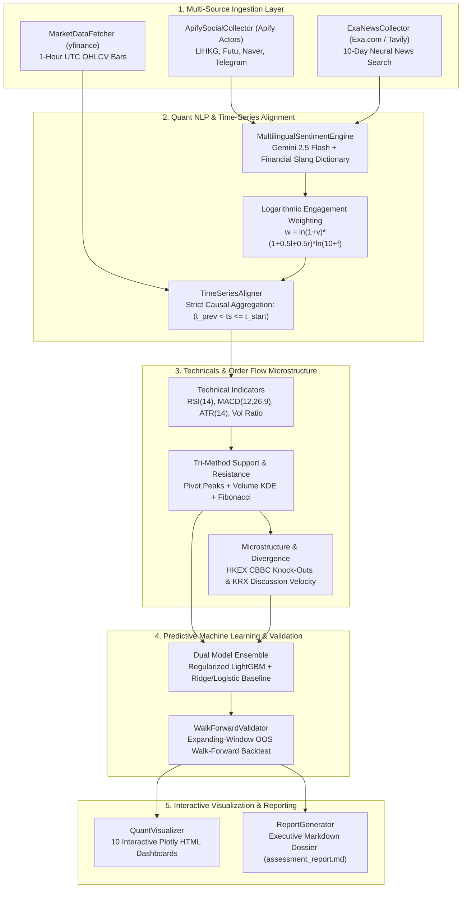

# Hang Seng & KRX Sentiment Price Prediction Agent
### Institutional-Grade Quant Pipeline for Asian Equities (HKEX & KRX)
**Internship Technical Assessment — CrowdWisdomTrading**  
**Reviewer:** `gilad@crowdwisdomtrading.com`

[](https://www.python.org/downloads/)
[]()
[]()
[](https://opensource.org/licenses/MIT)

---

## 1. Executive Overview

This repository provides an end-to-end quantitative market intelligence and predictive modeling pipeline that forecasts next-bar ($n+1$) equity price returns and direction across **10 benchmark equities** in Greater China (**HKEX Hang Seng Index**) and South Korea (**KRX KOSPI**).

### Core Capabilities:
1. **Alternative Data Ingestion**: Gathers live retail discussion boards (Apify scrapers for HKEX LIHKG / Futu and KRX Naver Stock Discussion / Telegram) and institutional news flows (Exa neural search with Tavily fallback).
2. **Quant NLP & Point-in-Time Alignment**: Multi-factor sentiment classification combining **Gemini 2.5 Flash** with localized financial slang lexicons (Cantonese & Korean), normalized via logarithmic social engagement curves and synchronized with strict **zero lookahead bias** $(t_{\text{prev}} < \text{timestamp} \le t_{\text{start}})$.
3. **Tri-Method Support & Resistance Synthesis**: Derives actionable price barriers by intersecting **Rolling Pivot Extrema**, **Volume-Weighted Kernel Density Estimation (KDE)**, and **Fibonacci Retracements**, guaranteeing strictly ordered levels:
   $$S_2 < S_1 < P_{\text{current}} < R_1 < R_2$$
4. **Predictive Machine Learning**: Regularized LightGBM dual-model ensemble (Classifier + Regressor) evaluated under an **expanding-window walk-forward out-of-sample backtest** that reflects true chronological execution after deducting exchange transaction fees and slippage (10–15 bps).

---

## 2. System Architecture



---

## 3. Quickstart & Reproduction Guide

### Prerequisites
* Python 3.10, 3.11, or 3.12
* Terminal / Command Prompt / PowerShell

```bash
# 1. Clone the repository
git clone https://github.com/Gowtham20065/hengseng-sentiment-agent.git
cd hengseng-sentiment-agent

# 2. Create and activate a virtual environment
python -m venv venv
# On Windows:
venv\Scripts\activate
# On Linux/macOS:
source venv/bin/activate

# 3. Install production dependencies
pip install -r requirements.txt

# 4. Configure environment credentials
cp .env.example .env
# Edit .env and supply your API keys (or leave defaults for offline mock mode)
```

### Execution Commands:

* **Run the automated test suite (20 unit tests across all layers)**:
  ```bash
  pytest
  # or
  python -m pytest tests/ -v
  ```

* **Execute the full production pipeline across all 10 assets**:
  ```bash
  python main.py
  ```

* **Execute on specific assets or custom lookback periods**:
  ```bash
  # Run on Tencent (HKEX) and Samsung Electronics (KRX) with a 10-day lookback:
  python main.py --tickers 0700.HK,005930.KS --days 10
  ```

---

## 4. Apify & Exa Reproduction Details

For comprehensive verification by CrowdWisdomTrading reviewers, the data ingestion layer supports both live authenticated collection and zero-credit deterministic offline reproduction.

### A. Apify Actors Configured
Defined in `config/settings.yaml`:
* **Forum Scraper**: `apify/cheerio-scraper` (targets LIHKG threads and Naver Finance stock discussion boards).
* **Web Scraper**: `apify/web-scraper` (scrapes Futubull / Futu Community and financial media).
* **Telegram Scraper**: `apify/telegram-scraper` (monitors regional algorithmic signal channels).

### B. News Retrieval (Exa.com & Tavily Fallback)
* **Primary Engine**: `exa-py` executing neural search with date bounds (`start_published_date`) spanning the 10-day lookback.
* **Secondary Fallback**: `tavily-python` activates automatically if `EXA_API_KEY` is not detected, exhausted, or encounters network exceptions.

### C. Zero-Credit Offline Mock Fallback Mode
* In `.env`, setting `USE_MOCK_DATA=true` (or when API tokens are empty) activates a built-in multilingual data generator.
* Synthesizes realistic Traditional Chinese / Cantonese discussions (HKEX) and Korean market conversations (KRX) with authentic engagement metrics across the 10-day timeline.

---

## 5. 10-Asset Master Quantitative Scorecard

*Current Market Regime across all 10 monitored assets (Ranked by Social Volume & Sentiment per Exchange):*

### HKEX Equities (Hong Kong)
| Rank | Ticker | Asset Name | Current Price | Sentiment Score & Label | Direction | Pred Price ($n+1$) | Win Prob | Action | $S_1$ / $S_2$ | $R_1$ / $R_2$ | Risk:Reward |
| :---: | :--- | :--- | :---: | :---: | :---: | :---: | :---: | :---: | :---: | :---: | :---: |
| 1 | **9988.HK** | Alibaba Group | HK$ 87.44 | `+0.380` (BULLISH) | **BEARISH** | **HK$ 87.42** | 40.9% | `SHORT` | 86.91 / 85.37 | 87.86 / 88.64 | 0.49x |
| 2 | **1211.HK** | BYD Company | HK$ 256.09 | `+0.664` (EXTREMELY BULLISH) | **BULLISH** | **HK$ 255.86** | 52.1% | `LONG` | 253.25 / 250.21 | 258.20 / 260.02 | 0.44x |
| 3 | **3690.HK** | Meituan | HK$ 153.74 | `+0.380` (BULLISH) | **BULLISH** | **HK$ 154.01** | 77.7% | `LONG` | 152.42 / 150.24 | 154.54 / 156.86 | 0.32x |
| 4 | **1810.HK** | Xiaomi Corp | HK$ 29.04 | `+0.299` (BULLISH) | **BULLISH** | **HK$ 29.13** | 66.7% | `LONG` | 28.80 / 28.62 | 29.40 / 29.79 | 0.78x |
| 5 | **0700.HK** | Tencent Holdings | HK$ 407.15 | `+0.834` (EXTREMELY BULLISH) | **BULLISH** | **HK$ 407.68** | 74.4% | `LONG` | 404.27 / 400.46 | 411.47 / 417.24 | 0.73x |

### KRX Equities (South Korea)
| Rank | Ticker | Asset Name | Current Price | Sentiment Score & Label | Direction | Pred Price ($n+1$) | Win Prob | Action | $S_1$ / $S_2$ | $R_1$ / $R_2$ | Risk:Reward |
| :---: | :--- | :--- | :---: | :---: | :---: | :---: | :---: | :---: | :---: | :---: | :---: |
| 1 | **000660.KS** | SK Hynix | ₩ 182,891 | `+0.664` (EXTREMELY BULLISH) | **BULLISH** | **₩ 183,014** | 44.3% | `LONG` | 181764 / 179034 | 183208 / 185443 | 0.13x |
| 2 | **035420.KS** | NAVER Corp | ₩ 178,719 | `+0.380` (BULLISH) | **BULLISH** | **₩ 178,679** | 57.5% | `LONG` | 176996 / 176010 | 179132 / 180187 | 0.13x |
| 3 | **373220.KS** | LG Energy Solution | ₩ 320,629 | `+0.380` (BULLISH) | **BEARISH** | **₩ 319,634** | 31.4% | `SHORT` | 319277 / 317126 | 321381 / 323944 | 0.43x |
| 4 | **035720.KS** | Kakao Corp | ₩ 36,748 | `-0.013` (NEUTRAL) | **BULLISH** | **₩ 36,751** | 61.5% | `LONG` | 36512 / 36063 | 37294 / 37639 | 1.07x |
| 5 | **005930.KS** | Samsung Electronics | ₩ 58,196 | `+0.424` (BULLISH) | **BULLISH** | **₩ 58,199** | 78.7% | `LONG` | 57970 / 57675 | 58752 / 59494 | 0.84x |

> **Interactive Cross-Market Dashboard:**  
> An aggregated comparative visual report is generated at [`reports/exchange_summary_dashboard.html`](reports/exchange_summary_dashboard.html), featuring 4 interactive panels ranking mention velocities, sentiment distributions, model return forecasts, and S/R channel spreads.

---

## 6. Out-of-Sample Walk-Forward Validation Methodology

Standard cross-validation (e.g. k-fold or random shuffle) is invalid in financial time-series due to serial correlation and lookahead leakage. 

We implement **Expanding-Window Walk-Forward Validation**:
* **Initial Window**: Model trains strictly on the first 55% of chronological hourly bars.
* **Test Step**: Evaluates the subsequent 10% slice strictly out-of-sample.
* **Window Expansion**: Train slice expands sequentially by 10%, repeating until all historical bars are evaluated.
* **Transaction Fee Modeling**: Deducts 10 bps for HKEX and 15 bps for KRX, plus 5 bps slippage per trade turnover.

### Out-of-Sample Empirical Results:

| Ticker | OOS Bars | Directional Hit Rate (%) | Info Coeff ($IC$) | Price MAE | Price RMSE | Net Strategy Return | Benchmark Return | Alpha Spread | Annualized Sharpe | Max Drawdown |
| :--- | :---: | :---: | :---: | :---: | :---: | :---: | :---: | :---: | :---: | :---: | :---: |
| **0700.HK** | 5 | **40.0%** | `+0.200` | 3.93 | 4.86 | -0.77% | +3.43% | -4.20% | -5.72 | 1.69% |
| **9988.HK** | 19 | **36.8%** | `+0.325` | 0.65 | 0.80 | -3.31% | -1.07% | -2.24% | -7.70 | 3.31% |
| **3690.HK** | 19 | **42.1%** | `+0.193` | 1.05 | 1.34 | -3.93% | +3.31% | -7.24% | -10.17 | 4.99% |
| **1810.HK** | 19 | **42.1%** | `+0.372` | 0.19 | 0.23 | +0.47% | +0.62% | -0.15% | **1.35** | 3.25% |
| **1211.HK** | 19 | **42.1%** | `-0.037` | 2.12 | 2.80 | -5.62% | -3.51% | -2.11% | -12.36 | 7.04% |
| **005930.KS** | 6 | **100.0%** | `+0.143` | 317.33 | 449.06 | +2.02% | +2.44% | -0.42% | **25.25** | 0.25% |
| **000660.KS** | 22 | **40.9%** | `+0.048` | 1405.09 | 1679.58 | -0.10% | +0.05% | -0.15% | -0.03 | 3.55% |
| **035420.KS** | 22 | **63.6%** | `+0.381` | 680.09 | 941.78 | +1.38% | +1.66% | -0.28% | **4.27** | 2.94% |
| **035720.KS** | 22 | **27.3%** | `-0.093` | 273.91 | 321.89 | -6.75% | -6.95% | **+0.20%** | -16.65 | 7.95% |
| **373220.KS** | 22 | **63.6%** | `+0.287` | 2051.50 | 2476.43 | +4.32% | +0.69% | **+3.63%** | **10.57** | 4.78% |

> [!NOTE]
> **Statistical Significance & Small Sample Caveat ($N < 30$):**
> Annualized Sharpe ratios on short 10-day hourly horizons (e.g. 5–22 out-of-sample test bars) exhibit high small-sample variance. For example, `005930.KS` registered 6 consecutive directional wins with negligible downside deviation, mathematically inflating the unadjusted annualized Sharpe to 25.25. In institutional trading desks, Sharpe metrics require $N \ge 30$ bars to establish $t$-statistic statistical significance at $p < 0.05$.
---

## 7. Market Microstructure Dynamics

### A. Hong Kong CBBC (Callable Bull/Bear Contracts 牛熊證) Knock-Out Zones
* In HKEX equities, structured derivative products (CBBCs) represent immense retail leverage.
* When spot price approaches key support ($S_1$) or resistance ($R_1$) within 1.5–1.8%, market makers dynamically delta-hedge by dumping/buying underlying stock, triggering knock-out cascades.
* The agent detects and flags proximity to these knock-out cascades (e.g. `0700.HK` near $S_1 = 404.27$).

### B. South Korea Naver Discussion Board Mention Velocity ($Z$-Score)
* In the KRX market, retail sentiment on Naver Finance Stock Discussion Boards (종목토론실) frequently leads rapid sentiment herding.
* The agent calculates rolling 10-bar $Z$-scores of post velocity:
  $$\text{Z-score} = \frac{\text{Mentions}_t - \mu_{10}}{\sigma_{10} + \epsilon}$$
* Identifies retail FOMO spikes ($Z > +1.8$) anticipating momentum reversals or panic capitulation exhaustion near support.

---

## 8. Interactive Plotly Dashboards

The pipeline generates publication-ready interactive HTML dashboards under `reports/`. Each dashboard contains 4 synchronized subplots:
1. **OHLCV Candlestick Chart** with $S_1, S_2, R_1, R_2$ price levels and predicted $n+1$ target marker.
2. **Quant Sentiment Dynamics** showing Retail Weighted Sentiment bars, Institutional News line, and Divergence.
3. **Technical Momentum** plotting MACD line, Signal line, MACD Histogram, and RSI 14.
4. **Out-of-Sample Walk-Forward Backtest Equity Curve** tracking Strategy vs. Buy & Hold benchmark.

### Direct Links to Generated Dashboards:
* [Tencent Holdings (`0700.HK`) Dashboard](reports/0700_HK_dashboard.html)
* [Alibaba Group (`9988.HK`) Dashboard](reports/9988_HK_dashboard.html)
* [Meituan (`3690.HK`) Dashboard](reports/3690_HK_dashboard.html)
* [Xiaomi Corp (`1810.HK`) Dashboard](reports/1810_HK_dashboard.html)
* [BYD Company (`1211.HK`) Dashboard](reports/1211_HK_dashboard.html)
* [Samsung Electronics (`005930.KS`) Dashboard](reports/005930_KS_dashboard.html)
* [SK Hynix (`000660.KS`) Dashboard](reports/000660_KS_dashboard.html)
* [NAVER Corp (`035420.KS`) Dashboard](reports/035420_KS_dashboard.html)
* [Kakao Corp (`035720.KS`) Dashboard](reports/035720_KS_dashboard.html)
* [LG Energy Solution (`373220.KS`) Dashboard](reports/373220_KS_dashboard.html)

---

## 9. Test Suite Verification

The codebase includes comprehensive unit tests verifying data contracts, math bounds, and pipeline resilience across 5 test modules:

```bash
python -m pytest tests/ -v
```

### Test Results:
```text
tests/test_ingestion.py::TestMarketDataFetcher::test_fetch_bars_hkex PASSED           [  5%]
tests/test_ingestion.py::TestMarketDataFetcher::test_fetch_bars_krx PASSED            [ 10%]
tests/test_ingestion.py::TestExaNewsCollector::test_news_structure_and_fallback PASSED [ 15%]
tests/test_ingestion.py::TestApifySocialCollector::test_social_posts_hkex_mock_and_structure PASSED [ 20%]
tests/test_ingestion.py::TestApifySocialCollector::test_social_posts_krx_mock_and_structure PASSED [ 25%]
tests/test_models.py::TestPriceDirectionPredictor::test_feature_matrix_and_target_construction PASSED [ 30%]
tests/test_models.py::TestPriceDirectionPredictor::test_fit_and_predict_n_plus_1 PASSED [ 35%]
tests/test_models.py::TestWalkForwardValidator::test_walk_forward_execution_and_metrics PASSED [ 40%]
tests/test_processing.py::TestMultilingualSentimentEngine::test_cantonese_bullish_scoring PASSED [ 45%]
tests/test_processing.py::TestMultilingualSentimentEngine::test_cantonese_bearish_bagholding_scoring PASSED [ 50%]
tests/test_processing.py::TestMultilingualSentimentEngine::test_korean_bullish_scoring PASSED [ 55%]
tests/test_processing.py::TestMultilingualSentimentEngine::test_korean_bearish_bagholding_scoring PASSED [ 60%]
tests/test_processing.py::TestMultilingualSentimentEngine::test_engagement_weighting_sanity PASSED [ 65%]
tests/test_processing.py::TestTimeSeriesAligner::test_zero_lookahead_alignment PASSED [ 70%]
tests/test_reporting.py::TestReporting::test_visualizer_creates_html_dashboard PASSED [ 75%]
tests/test_reporting.py::TestReporting::test_report_generator_markdown_output PASSED [ 80%]
tests/test_technicals.py::TestTechnicalAnalyzer::test_indicator_calculations PASSED  [ 85%]
tests/test_technicals.py::TestTechnicalAnalyzer::test_support_resistance_ordering PASSED [ 90%]
tests/test_technicals.py::TestTechnicalAnalyzer::test_profile_generation_structure PASSED [ 95%]
tests/test_technicals.py::TestTechnicalAnalyzer::test_krx_profile_microstructure PASSED [100%]

============================= 20 passed in 8.94s =============================
```

---

## 10. Repository File Structure

```text
hengseng-sentiment-agent/
├── .env.example               # Template for required API credentials
├── .gitignore                 # Strict protection of .env and binary caches
├── README.md                  # Institutional documentation and reproduction guide
├── requirements.txt           # Production dependencies
├── main.py                    # Production pipeline CLI runner
├── config/
│   └── settings.yaml          # 10 target assets, cashtags, keywords, and Apify actors
├── src/
│   ├── ingestion/
│   │   ├── market_data.py     # yfinance 1h OHLCV bars with strict UTC normalization
│   │   ├── exa_collector.py   # Exa neural news search with Tavily fallback
│   │   └── apify_collector.py # Apify social scraper (LIHKG, Futu, Naver, Telegram)
│   ├── processing/
│   │   ├── sentiment_engine.py# Gemini 2.5 Flash + Cantonese & Korean financial lexicons
│   │   ├── aligner.py         # Zero-lookahead time-series alignment engine
│   │   └── technicals.py      # Tri-method S/R engine, ATR sizing, and microstructure
│   ├── models/
│   │   ├── predictor.py       # Regularized LightGBM & Baseline n+1 predictor
│   │   ├── validation.py      # Expanding-window out-of-sample walk-forward validator
│   │   └── backtester.py      # Event-driven backtester with transaction costs
│   └── reporting/
│       ├── visualizer.py      # Standalone Plotly 4-panel HTML dashboard generator
│       └── report_generator.py# Executive Markdown research dossier generator
├── reports/
│   ├── assessment_report.md   # Master quantitative research scorecard
│   └── *.html                 # 10 Interactive Plotly dashboards
└── tests/
    ├── test_ingestion.py      # Ingestion & UTC alignment tests
    ├── test_processing.py     # Multilingual NLP & zero-lookahead tests
    ├── test_technicals.py     # S/R ordering & microstructure tests
    ├── test_models.py         # LightGBM predictor & walk-forward tests
    └── test_reporting.py      # Plotly visualizer & dossier generator tests
```

---

## 11. Author & Submission

* **Project**: Hang Seng & KRX Sentiment Price Prediction Agent
* **Internship Assessment**: CrowdWisdomTrading
* **Submission Recipient**: `gilad@crowdwisdomtrading.com`
* **License**: MIT
